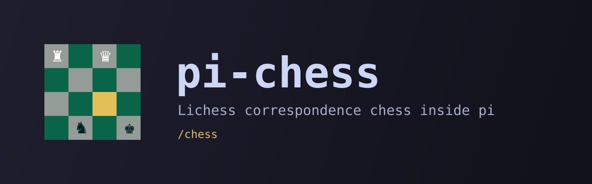

# pi-chess

<picture>
  <source media="(prefers-color-scheme: dark)" srcset="assets/banner-dark.svg">
  <source media="(prefers-color-scheme: light)" srcset="assets/banner-light.svg">
  
</picture>

```bash
pi install https://github.com/denismrvoljak/pi-chess
```

Lichess correspondence chess for pi.

`pi-chess` adds a `/chess` command to [pi](https://github.com/earendil-works/pi). It shows a chess board above the input box, and the agent keeps working while you play.

## What this is

`pi-chess` is a pi package for playing correspondence chess on [Lichess](https://lichess.org) without leaving the terminal. It is meant for slow games beside your work: make a move, close the board, and come back when it is your turn.

Every game lives on Lichess. The package saves no game state, makes no model calls, and puts no position or move into the conversation.

## What it does

- opens your ongoing Lichess games and shows whose move it is
- lists incoming challenges, so you can accept them from pi
- challenges a Lichess friend, any Lichess user, or anyone through a public seek
- opens the Lichess daily puzzle, with no login
- starts every game as casual correspondence with 3 days per move
- draws the board in two sizes
- logs in through the Lichess consent page in the browser, with no app registration

## Install

### From GitHub

```bash
pi install https://github.com/denismrvoljak/pi-chess
```

Then run `/reload`. pi installs the one dependency, `chess.js`.

### Local path install

Use this when developing on the package itself:

```bash
npm install
pi install /absolute/path/to/pi-chess
pi list
```

## Commands

| Command | What it does |
|---|---|
| `/chess` | Opens the only ongoing game. Otherwise it shows a menu: open a game, accept a challenge, start a new game, or solve the daily puzzle. |
| `/chess new` | Starts a game. Post a public Lichess seek, pick one of the players you follow on Lichess, or type a username. |
| `/chess puzzle` | Opens the Lichess daily puzzle. It needs no login. |
| `/chess <user>` | Challenges a Lichess user. |
| `/chess accept` | Accepts the first incoming challenge and opens the game. |
| `/chess stop` | Closes the board, or cancels a login that waits for the browser. |
| `/chess logout` | Deletes the saved token. |

A challenge or a seek returns at once, because the opponent can take days to answer. Run `/chess` again after they accept. The menu title names the opponents who have not yet answered a challenge that you sent.

## Playing

| Key | Action |
|---|---|
| Arrows | Move the cursor |
| Enter or Space | Select a piece, then move it |
| `b` | Switch the board size |
| `R` twice | Resign |
| Escape | Close the board. The game continues on Lichess. |

- The small board is 9 rows. The large board is 18 rows, with near-square fields, and needs a terminal with at least 28 rows.
- The board takes every key while it is open. Press Escape to type to the agent.
- A finished game shows its result and stays until Escape or the next `/chess`.
- A pawn always promotes to a queen.

## Daily puzzle

The board shows the puzzle position from the side to move. Play the best move: a right move is answered by the opponent's reply, and a wrong move is refused so you can try again. As on Lichess, any checkmate counts as right.

## Login

The first `/chess` opens the Lichess consent page in the browser. It uses OAuth with PKCE, so there is no app registration and no client secret. The requested scopes are `board:play`, `challenge:read`, `challenge:write` and `follow:read`. The last one lists the players you follow, for the new-game picker.

The token is saved to `~/.config/pi-chess/token` with mode 600. When Lichess rejects the token, the package deletes it, and the next `/chess` logs in again.

On a machine without a browser, set `LICHESS_TOKEN` to a personal Lichess token with the same scopes.

`/chess logout` deletes the local file only. Revoke the token at lichess.org/account/security.

## Local development workflow with `/reload`

```bash
cd /absolute/path/to/pi-chess
npm install
pi install /absolute/path/to/pi-chess
```

Edit a file, then run `/reload` in pi and `/chess` again.

## Development and verification commands

```bash
npm test
npm run check
```

The tests cover move replay, legal moves, board drawing, the game stream reader, the API client, and the login against a local stand-in, the friends list, and the puzzle logic.

## Known limitations

- **One puzzle a day.** Only the Lichess daily puzzle is offered, and a solved puzzle is not reported to Lichess.
- **Standard chess only.** A variant game fails to open.
- **No reconnect.** A dropped game stream closes the board with an error. Run `/chess` again.
- **No draw offers, chat or move list.**
- **No cancel for a sent challenge.** Cancel it on lichess.org.
- **No automated test for the pi wiring.** The file that connects the parts to pi is checked by hand.
- **24-bit colour.** The board needs a terminal with true colour.

## License

MIT
